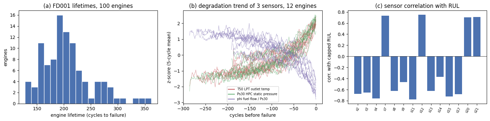
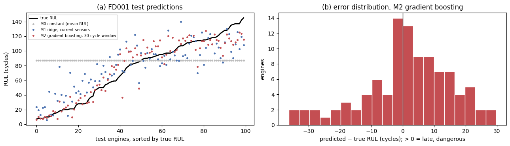

# Safety-aware remaining-useful-life prediction for turbofan engines

ML course project, Naji El Kharsa (AUB).

The goal is to predict how many operating cycles an aircraft engine has left before failure (remaining useful life,
RUL) from its sensor history, using the NASA C-MAPSS run-to-failure simulations [Saxena et al., 2008]. The
project compares simple baselines, gradient boosting on window features and sequence models (1D-CNN / LSTM), and adds
**quantile (lower-bound) prediction** to reduce *late* predictions, which are the dangerous errors in maintenance.

## Setup

```bash
pip install -r requirements.txt
python baseline.py          # or open baseline.ipynb in Google Colab and Runtime -> Run all
```

`baseline.py` downloads the data from NASA's open-data portal (fallback: a Hugging Face mirror), prints data checks,
saves `fig_eda.png` and `fig_baseline.png`, runs the baselines with 5-fold engine-wise cross-validation plus one
evaluation on the official FD001 test set, and writes all numbers to `results.json`. The raw data are not
committed (see `.gitignore`).

## Data

NASA Prognostics Center of Excellence, *Turbofan Engine Degradation Simulation Data Set (C-MAPSS)*,
https://data.nasa.gov/docs/legacy/CMAPSSData.zip. A. Saxena, K. Goebel, D. Simon, N. Eklund, "Damage Propagation
Modeling for Aircraft Engine Run-to-Failure Simulation", PHM 2008.

## Current baselines (FD001)

Results from `baseline.ipynb` (run in Google Colab). Validation = 5-fold cross-validation grouped by engine;
test = the official FD001 test set (100 engines, last cycle). RUL target capped at 125 cycles.
NASA score = asymmetric PHM08 score (late predictions cost more); "Late" = share of test engines where the
predicted RUL is larger than the true RUL.

| Model | Train RMSE | Val RMSE | Test RMSE | Test MAE | NASA score | Late |
|---|---|---|---|---|---|---|
| M0 constant (mean) | 41.67 | 41.67 | 43.07 | 35.90 | 33629 | 50% |
| M1 ridge regression | 21.48 | 21.57 ± 1.08 | 21.90 | 17.61 | 1314 | 59% |
| M2 gradient boosting (30-cycle window features) | 4.63 | 12.96 ± 0.76 | 14.11 | 10.76 | 277.5 | 58% |




## Files

- `baseline.ipynb`: data download, checks, figures and baselines (with outputs)
- `baseline.py`: the same pipeline as a script
- `requirements.txt`: Python packages

## Plan

1. Baselines: constant, ridge, gradient boosting on 30-cycle window features (done).
2. Sequence models: 1D-CNN and LSTM on sliding windows (PyTorch).
3. Safety-aware RUL: quantile / asymmetric loss, measuring the share of late predictions.
4. Generalisation to six operating conditions (FD002 / FD004) with condition-wise normalisation.
